# Autonomous Root Tip Inoculation: Computer Vision and Reinforcement Learning

An end-to-end system that detects plant root tips in petri dish images and positions a pipette on each tip with sub-millimeter accuracy, built for NPEC (Netherlands Plant Eco-phenotyping Centre). A U-Net finds the roots, a coordinate transform maps tips into robot space, and a controller moves the pipette of a simulated Opentrons OT-2 liquid-handling robot to inoculate each tip. Reinforcement learning (RL) and PID control were compared, and PID was chosen.

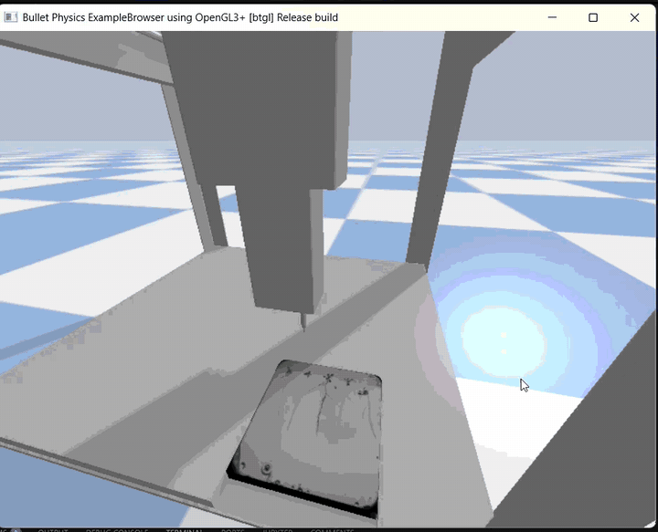

## Highlights

- **Rank 8 on the private leaderboard (top 10%)** of a Kaggle competition on root length prediction, which depends on correct root tip identification: sMAPE (symmetric mean absolute percentage error) **6.180**. 
- **0.132 mm** mean positioning error over 10 plates and 45 roots (requirement: < 1 mm), with a **100%** success rate.
- RL (PPO) vs PID compared on identical targets: PID was ~8× more accurate and ~1.8× faster.
- Full pipeline benchmarked: 21.6 s per plate, 13.89 tips per minute.

---

## Context: Why NPEC Needs This

NPEC's Hades system phenotypes plant-microbe interactions in *Arabidopsis thaliana* grown in petri dishes.

- Manual root analysis and inoculation do not scale to thousands of plants.
- Targeted microbial treatments need precise root tip localization.
- Root systems get complicated by lateral roots and overlap with shoots.

**Value:** supports high-throughput root phenotyping in Hades, increases accuracy and reduces manual labor in root measurements, and gives higher-quality data for plant-microbe interaction studies.

---

## System Overview

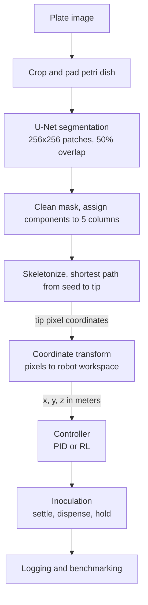

1. **Plate loading:** the simulation loads a random specimen plate texture.
2. **Image retrieval:** the plate image is taken from the simulation. On a real setup this step would be a live camera.
3. **Root detection:** U-Net segmentation, then root tip positions in pixel coordinates.
4. **Coordinate transformation:** pixels to robot workspace coordinates in meters.
5. **Motion control:** PID moves the pipette to the tip.
6. **Inoculation:** a single drop is dispensed on the tip.
7. **Iteration:** repeated for all five plants on the plate.

**Assumptions:** each plate has 5 plants, the primary root extends furthest downward (no interfering laterals), and all plants sit at the same depth, so Z is fixed.

## Tech Stack

| Area | Tools |
|---|---|
| Simulation | PyBullet (OT-2 simulation), Gymnasium (custom RL environment) |
| Reinforcement learning | Stable-Baselines3 (PPO, MLP policy) |
| Experiment tracking | ClearML (remote GPU training, model versioning), Docker |
| Computer vision | TensorFlow/Keras (U-Net), patchify, OpenCV, scikit-image, skan, NetworkX |
| Analysis | NumPy, pandas, Matplotlib, seaborn |

---

## 1. Computer Vision Pipeline

**Task:** for each plate, find the root tip of each of the 5 plants and return its pixel coordinates and root length.

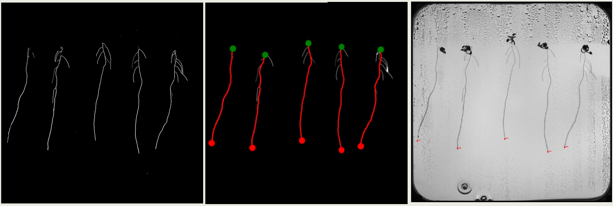

*Left to right: skeletonized roots, traced main root (green: seed start, red: main root and its tip), and the detected tips on the plate.*

### Segmentation model
- U-Net trained to predict a binary root mask per 256×256 patch, with binary cross-entropy loss for 10 epochs.
- **F1 score 0.86**, loss 0.003.

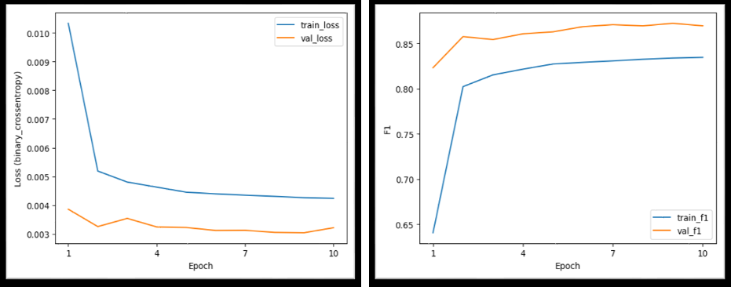

### Preprocessing
The petri dish is found with Otsu thresholding and contour detection, and the image is cropped to a square centered on the dish. It is then padded so both sides are divisible by 256 px, so any input size works with the U-Net.

### Inference and mask cleaning
- The padded image is split into overlapping 256×256 patches (50% stride), normalized, and passed through the U-Net.
- Patch predictions are merged back with weighted averaging to avoid visible seams.
- The mask is binarized at 0.5, closed morphologically (kernel 5, 2 iterations) to reconnect broken root segments, and very small noise regions are removed.

### Root component identification
- Connected component analysis finds individual root structures.
- The plate is split into 5 vertical columns. Noisy regions near the edges and the top of the image are ignored.
- Each component is assigned to a column by its centroid, and the largest component in a column is taken as the main root.

### Tip extraction
1. **Skeletonize** the root component to a 1-pixel centerline.
2. **Build a graph** with skan: nodes are skeleton endpoints and junctions, edges are branches weighted by length.
3. **Find the main axis:** take the topmost skeleton point (minimum y) and the bottommost point (maximum y) and compute the shortest weighted path between them with NetworkX, so the path follows the main root rather than side branches.
4. **Measure length:** sum the branch lengths along the path, plus a correction for the distance from the seed region to the first skeleton node.
5. **Tip:** the bottommost point on the path.

### Output
```
tips, image_dims = detect_root_tips(image_path, model)
# tips: [(plant_id, tip_x, tip_y, root_length), ...] in padded-image pixels
# image_dims: (width, height) of the padded image
# a plant with no detected root returns None
```

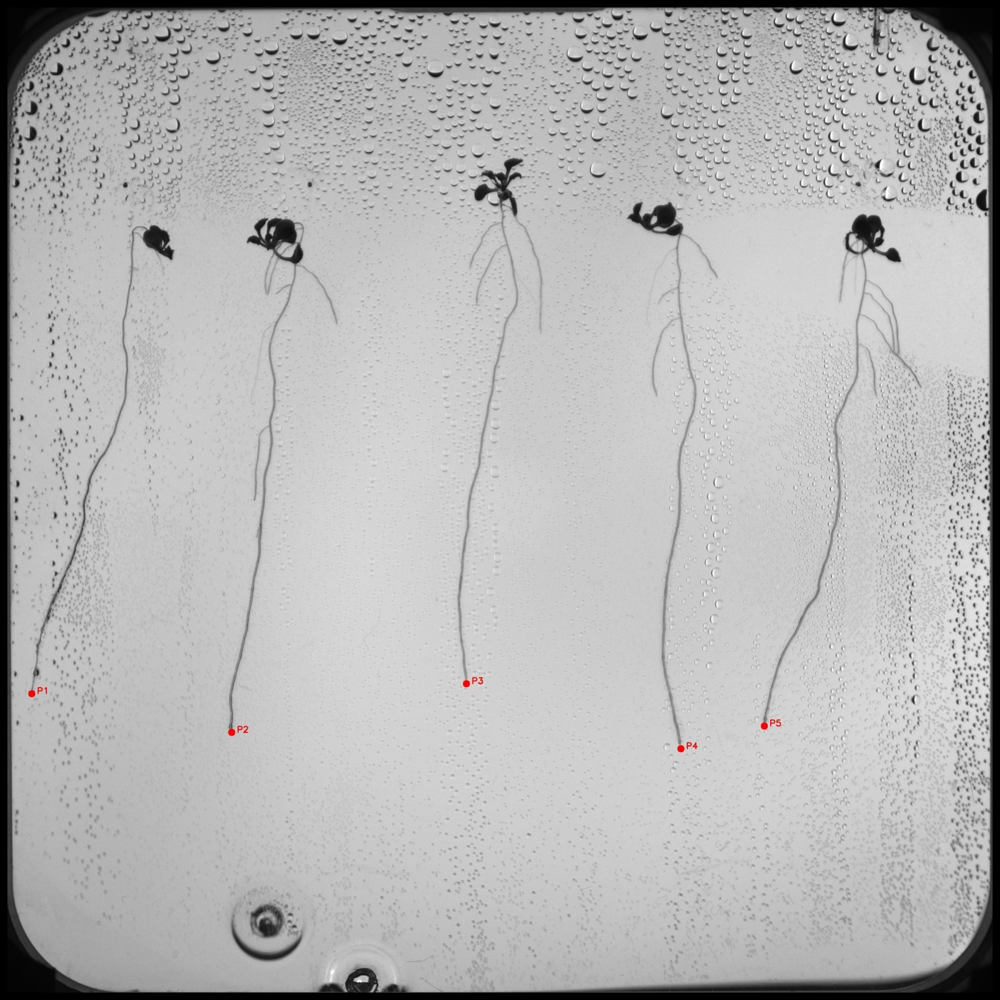

### Error analysis and iterations
| Issue | Fix | Result |
|---|---|---|
| Noise in the seed area formed a bigger component than the root | Separate the seed area and filter out noise from the top | sMAPE improved from 11% to 1.6% |
| Traced main root path did not start at the actual top of the root | Add the distance from the topmost pixel to the first skeleton node to the total length | Better sMAPE on the private leaderboard |

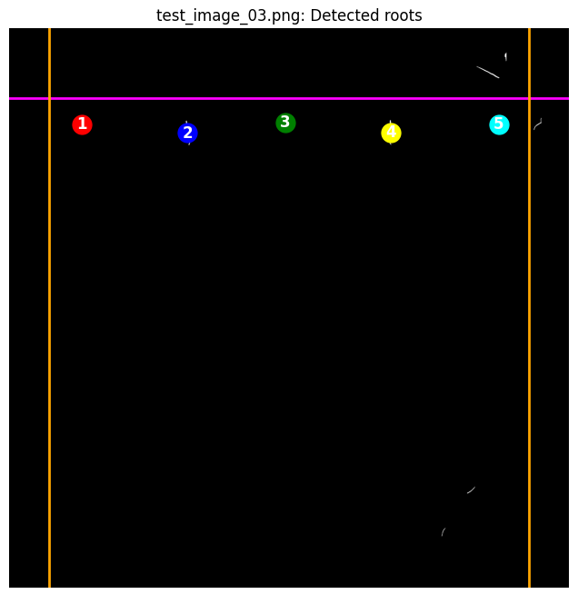

### Kaggle competition
The same pipeline, outputting root length per plant, was submitted to a Kaggle competition: predict the root length in pixels of each of 5 plants on 19 test plate images, scored with sMAPE. Result: **rank 8 on the private leaderboard, sMAPE 6.180, top 10%**.

---

## 2. Coordinate Transformation

**Task:** convert 2D tip pixels into 3D robot workspace coordinates.

The plate is known to be 150 × 150 mm, so a pixel-to-mm scale follows from the image dimensions (`scale = 150 mm / image size`).

1. **Center:** move the origin from the top-left corner to the image center.
2. **Swap axes:** the simulator frame is rotated relative to the image, so image vertical becomes simulation X and image horizontal becomes simulation Y.
3. **Scale** to millimeters.
4. **Add the plate center** in the workspace: (182.7 mm, 137.0 mm).
5. **Set a fixed inoculation height:** Z = 170 mm.
6. **Convert to meters** for PyBullet.

```
plate_relative_y = (pixel_x - width / 2)  * scale    # pixel_x -> world_y
plate_relative_x = (pixel_y - height / 2) * scale    # pixel_y -> world_x
```

Two bugs shaped this step:
- Tips looked shifted because detections are in padded-image space, so validation and scaling have to use the padded image size.
- The first Z (0.087 m) was below the robot's minimum reach (0.1195 m), so every move timed out. Raising it to 0.17 m fixed it.

---

## 3. Reinforcement Learning Controller

A PPO agent learns to move the pipette tip to a goal position.

### Environment
Custom Gymnasium wrapper (`OT2Env`) around the PyBullet OT-2 simulation.

| Component | Design | Reason |
|---|---|---|
| Observation | Normalized `[current_position, goal_position]` in [-1, 1] | Fully observable, stable for neural network training |
| Action | Continuous velocity commands | Native control interface of the simulated robot |
| Success | Distance to goal < 1 mm | Matches the accuracy requirement |

### Final reward
```
reward = -0.1                         # time penalty
         - 10.0 * distance_to_goal    # linear distance penalty
         + 50.0 if distance < 1 mm    # success bonus
```

### Training
- PPO with an MLP policy, trained remotely through ClearML in a Docker image for reproducibility.
- **Best hyperparameters:** learning rate 0.0001, batch size 128, n_steps 2048, 2,000,000 timesteps.
- Evaluated on 5 fixed random targets (seed 42), in deterministic and non-deterministic inference modes.

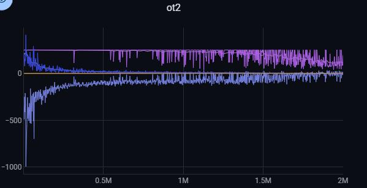

### Iterations and findings
- **Workspace bound bug:** a wrong Z bound in the environment capped success at ~82%. After the team fixed it, success reached 95-100% at 5 mm.
- **Complex rewards failed:** a multi-tier reward with distance milestones and a velocity penalty destabilized training. The simple linear reward worked best.
- **Hovering:** the policy approaches the goal, backs off, and wanders within 0.2-2 mm, giving a "good enough" stop at 1-2 mm. The distance penalty gives almost no gradient between 2 mm and 1 mm (`-10 × 0.002` vs `-10 × 0.001`), so the time penalty dominates.
- **Episode truncation:** ending training episodes early improved success but did not remove the hovering.

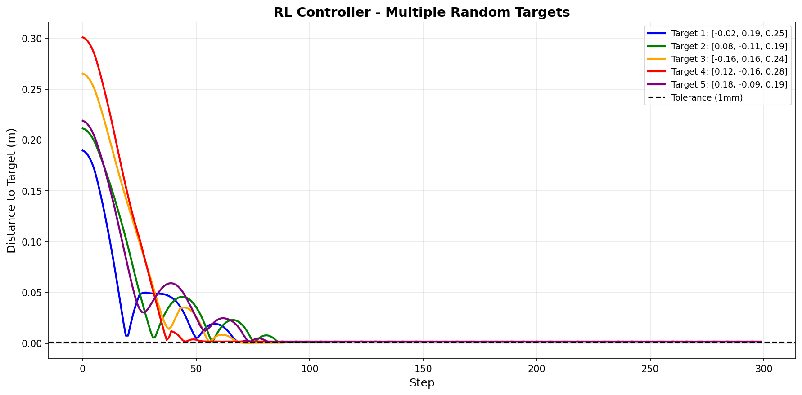

---

## 4. PID Controller

- Three independent controllers, one per axis. The final gains use only the proportional term, so it works as a P controller: velocity = Kp × position error, clipped to safe limits.

| Axis | Kp | Ki | Kd |
|---|---|---|---|
| X | 20 | 0 | 0 |
| Y | 30 | 0 | 0 |
| Z | 30 | 0 | 0 |

- Gains came from a per-axis grid search over Kp, Ki and Kd. Integral and derivative terms ended up unnecessary because the simulation is stable and low-friction.
- **Convergence criterion:** Euclidean distance to the goal < 1 mm for **20 consecutive steps**. If the error rises again, the check restarts. A maximum step limit acts as a safety stop.
- **Iteration:** early versions showed no velocity change during convergence and overshot. Adding a settling step inside the 1 mm threshold removed the overshoot and made the grid search results easier to compare.
- Everything is wrapped in `move_to_target_pid()`, which takes target coordinates and returns success plus error metrics, keeping control separate from perception.

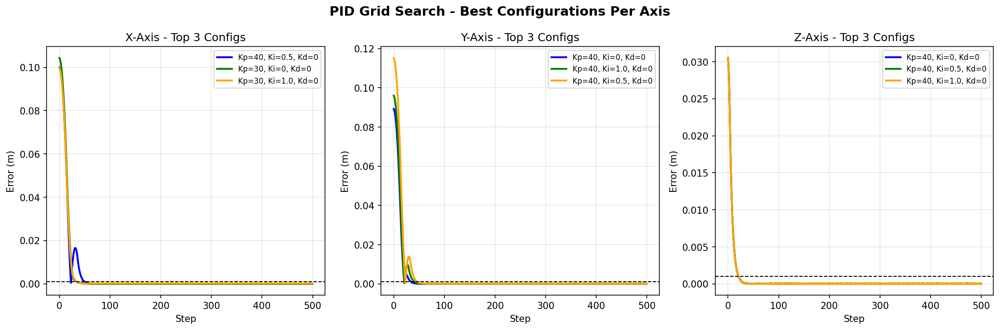

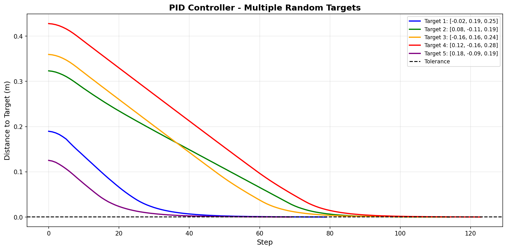

---

## 5. Controller Comparison: RL vs PID

Both controllers ran on the same 5 fixed random targets (seed 42).

| Metric | PID | RL (PPO) |
|---|---|---|
| Success rate | **100%** (5/5) | 40% (2/5) |
| Mean final error | **0.139 mm** | 1.134 mm |
| Best / worst error | 0.048 / 0.209 mm | 0.553 / 1.633 mm |
| Mean steps to converge | **99.6** | 177.6 |
| Consistency | Low variance | High variance |
| Training needed | None | Hours of GPU training |

PID was ~8× more accurate and ~1.8× faster per movement. Root tips need sub-millimeter accuracy, the task is point-to-point motion with clear dynamics, and the simulation is stable, so a classical controller was the better fit. RL would need more complex reward engineering (non-linear penalties, velocity-based terms) and longer training to compete.

---

## 6. System Integration and Inoculation

For each plate: detect tips, transform coordinates, move with PID, inoculate, log, then disconnect the simulation.

**Inoculation sequence (51 simulation steps, ~0.2 s):**
1. **Settle (20 steps):** let residual motion die out so the drop lands accurately.
2. **Dispense (1 step):** a single drop. The first version dispensed in a loop and released 50 drops.
3. **Hold (30 steps):** keep position while the drop transfers, to avoid splash or drift.

### Integration challenges

| Issue | Fix |
|---|---|
| Tips appeared shifted | Coordinates were in padded-image space, so used padded image dimensions |
| Robot moved vertically instead of horizontally | Rotated simulation axes, so swapped X and Y |
| All moves failed with max steps reached | Z was below minimum reach, so raised to 0.17 m |
| 50 drops per root | Single dispense action |
| PyBullet "multiple GUI connection" error on plate 2 | Disconnect the simulation after every plate, including plates with no detected roots |
| `int64` not JSON serializable | Recursive conversion of NumPy types before saving results |

---

## 7. Benchmark Results

10 specimen plates with varying root configurations, 45 roots in total. A movement counts as successful if the final error stays below 1 mm for 20 consecutive steps.

| Metric | Value |
|---|---|
| Successful inoculations | 45 / 45 (100%) |
| Mean drop location error | 0.132 mm |
| Median error | 0.125 mm |
| Std deviation of error | 0.062 mm |
| Mean control steps per tip | 55 |
| Mean time per tip | 0.787 s |
| Mean time per plate | 21.58 s |
| Throughput | 13.89 tips/min |


### Accuracy by plant position
Mean error is similar across the plate, which supports the coordinate transform being correct (no positional bias).

| Plant | 1 (left) | 2 | 3 (center) | 4 | 5 (right) |
|---|---|---|---|---|---|
| Mean error (mm) | 0.160 | 0.146 | 0.165 | 0.108 | 0.075 |


### Speed
- Most movements converge in 45-60 control steps (minimum 40, maximum ~90), and only ~9% need more than 60.
- There is no speed-accuracy trade-off: fast movements are as accurate as slow ones, because the settling criterion normalizes the final result.


### Time breakdown per plate

| Stage | Time | Share |
|---|---|---|
| Computer vision | 12.76 s | 59.1% |
| Robot movement | 3.94 s | 18.2% |
| Other (simulation setup, transforms, inoculation, logging) | 4.89 s | 22.7% |

CV takes around 3 times longer than robot movement because of the large padded image (2816×2816) and 50%-overlap patches, which repeat inference work.

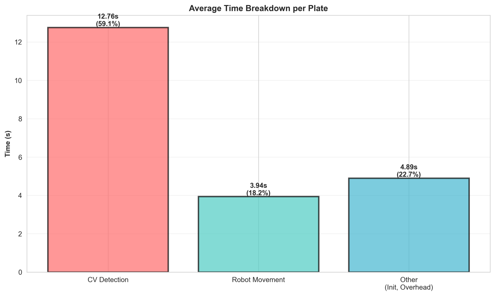

---

## 8. Limitations

| Limitation | Cause | Effect |
|---|---|---|
| Root-shoot overlap | Binary U-Net (root vs background) with no shoot class, trained mostly on clearly separated roots | Missed root pixels, shorter measured length, gaps in the skeleton |
| Lateral roots below the main tip | Tip is the bottommost skeleton point (max y) | Wrong target selected when a lateral root grows lower than the main root |
| Fixed 5-column layout | Hard-coded 5 columns | Fewer plants are reported as non-germinated, extra plants are ignored without warning |
| Small or early-stage roots | Training data biased to mature roots, fixed 0.5 threshold, low contrast | One test plate with three small roots was reported as having no roots |
| Noise in the seed area | The model predicts false root pixels around the seed | Can be mistaken for the main root without filtering |
| CV bottleneck | Large padded images, 50% overlap patches | 59% of runtime |
| Simulation only | | Not yet validated on a physical OT-2 |

## 9. Next Steps

- **Multiclass shoot-root segmentation** to reduce overlaps and improve root length calculation.
- **Primary vs lateral root classification**, so the tip no longer depends on the bottommost point.
- **Adaptive CV pipeline** that detects the number of plants instead of assuming a fixed layout. This needs cleaner masks, for example from a deeper U-Net.
- **Small-root detection:** add early-stage seedlings (small, thin, low contrast) to the training data.
- **Faster CV** (estimated 50-70% throughput gain): model compression, batch or asynchronous processing, region-of-interest pre-screening.
- **Better RL reward:** terms that reward convergence below 2 mm without discouraging movement.
- **Real hardware:** replace simulated images with a live camera and validate on a physical OT-2.

---


## Libraries

```
tensorflow==2.13.0   keras==2.13.1   opencv-python==4.9.0.80
scikit-image==0.22.0 skan==0.11.1    patchify==0.2.3
numpy==1.24.0        networkx==3.2.1 pandas  matplotlib  seaborn  pybullet
gymnasium  stable-baselines3  clearml
```
